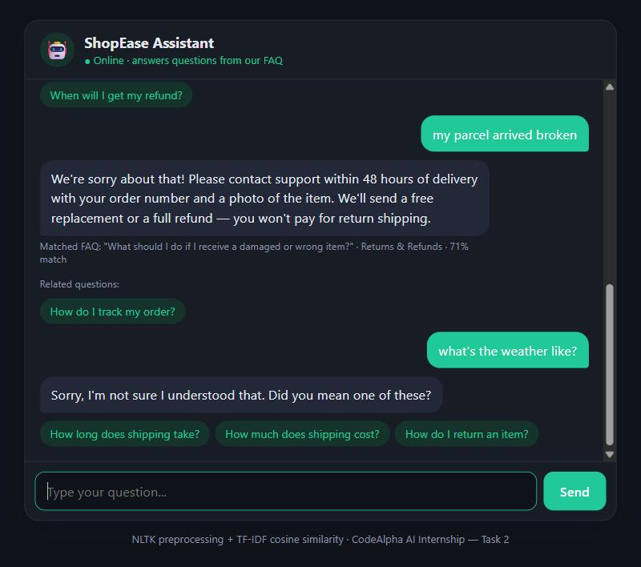

# FAQ Chatbot

**CodeAlpha AI Internship — Task 2**

🌐 **Live demo:** https://codealpha-faq-chatbot-sayan.netlify.app

A customer-support chatbot that answers questions from a list of FAQs. It uses **NLP preprocessing (NLTK)** and **TF-IDF + cosine similarity** to find the FAQ that best matches what the user typed — even when the wording is different or has typos — and shows the answer in a chat UI.

The FAQ set covers *ShopEase*, a fictional online store: orders, shipping, payments, returns & refunds, products, promotions, accounts and support (35 FAQs + small talk).



## Features

- 35 FAQs with alternative phrasings in a simple JSON file (`data/faqs.json`) — easy to change to any topic
- NLTK preprocessing: lowercasing, tokenization, punctuation & stopword removal, lemmatization
- Matching with **cosine similarity** on two TF-IDF representations:
  - word level (unigrams + bigrams) for meaning
  - character level (3–5 character n-grams) so typos like *"shiping"* still match
- Confidence threshold: if no FAQ is similar enough, the bot says so and suggests the closest questions instead of guessing
- Small talk (hi, thanks, bye, who are you)
- Chat UI with typing indicator, clickable suggestion chips, "related questions", and the matched FAQ + score shown under every answer
- Also works in the terminal (`python chatbot.py`)

## How it works

```
User question: "how long does shiping take??"
        │
        ▼
1. Preprocess (NLTK)   → ['how', 'long', 'ship', 'take']
        │
        ▼
2. Vectorize (TF-IDF)  → word-level vector + character-level vector
        │
        ▼
3. Cosine similarity against every FAQ question and its alternative phrasings
        │                                score = 0.6 × word_sim + 0.4 × char_sim
        ▼
4. Best FAQ: "How long does shipping take?"  (score 0.71 ≥ threshold 0.35)
        │
        ▼
5. Reply with its answer (+ related questions)
```

**Cosine similarity** measures the angle between two vectors: 1.0 = same direction (same words with the same importance), 0 = nothing in common. **TF-IDF** gives rare, meaningful words (*refund*, *password*) more weight than common ones.

## Run it

```bash
git clone https://github.com/sayan30082000/CodeAlpha_FAQChatbot.git
cd CodeAlpha_FAQChatbot
python -m venv venv
venv\Scripts\activate          # macOS/Linux: source venv/bin/activate
pip install -r requirements.txt

python app.py                  # web chat UI → http://127.0.0.1:5001
python chatbot.py              # or chat in the terminal
```

The required NLTK data (tokenizer, stopwords, WordNet) is downloaded automatically into `nltk_data/` on the first run.

## Use your own FAQs

Edit `data/faqs.json`. Each FAQ looks like this:

```json
{
  "id": "refund_time",
  "category": "Returns & Refunds",
  "question": "When will I get my refund?",
  "alternatives": ["How long does a refund take?", "I haven't received my money back"],
  "answer": "Once we receive and check your return ..."
}
```

More alternative phrasings = better matching. Restart the app after editing, and run `python export_web.py` to update the live (browser) version too.

## Live demo (browser version)

Netlify only hosts static files, so the live demo can't run Python. Instead, `export_web.py` exports everything the Python bot learned — the NLTK stopwords, a word → lemma table built with NLTK's lemmatizer, both TF-IDF vocabularies with their IDF weights, and the FAQ vectors — to `web/model.json`, and `web/engine.js` repeats the same preprocessing, TF-IDF and cosine-similarity steps in JavaScript.

It gives the **same answers as the Python bot**: on a test set of 311 questions (all FAQ phrasings, shortened variants, typos and off-topic questions) both versions picked the same answer every time, with identical similarity scores.

```bash
python export_web.py      # rebuild web/ after changing the FAQs or the code
```

## Project structure

```
CodeAlpha_FAQChatbot/
├── app.py            # Flask server: chat page + /api/chat endpoint
├── chatbot.py        # FAQBot: TF-IDF vectors, cosine similarity, thresholds, CLI
├── nlp_utils.py      # NLTK preprocessing (tokenize, stopwords, lemmatize)
├── export_web.py     # builds the browser version in web/
├── data/
│   └── faqs.json     # the FAQ knowledge base
├── templates/
│   └── index.html    # chat UI
├── static/
│   ├── style.css
│   └── app.js        # works with the Flask API or the in-browser engine
├── web/              # live site (Netlify): index.html, engine.js, model.json, ...
├── netlify.toml      # Netlify settings (publish web/)
├── screenshots/
└── requirements.txt
```

## API

`POST /api/chat` with `{"message": "can I pay with paypal"}` returns:

```json
{
  "answer": "We accept Visa, Mastercard and American Express ...",
  "matched_question": "What payment methods do you accept?",
  "category": "Payments",
  "score": 0.62,
  "suggestions": ["Do you offer cash on delivery?"]
}
```

## Tech stack

Python · Flask · NLTK · scikit-learn (TfidfVectorizer, cosine_similarity) · HTML/CSS/JavaScript · Netlify
